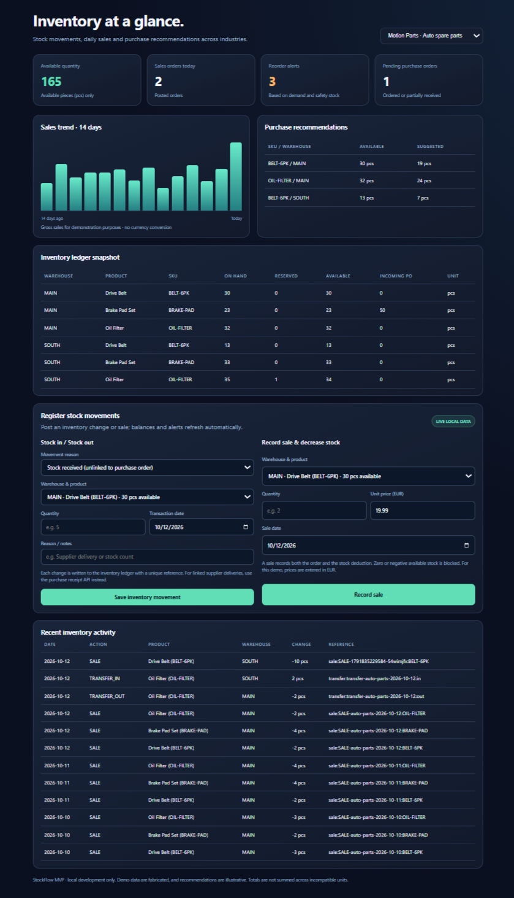

# StockFlow — Universal Inventory Monitoring & Reorder MVP

**Practical Python + SQLite + FastAPI inventory ledger** for different industries. Synthetic organizations simulate e-commerce, food wholesale, auto parts and office supplies. This is a locally testable proof of concept, not production software.

## Quick start (no Docker, no n8n required)

Python 3.10+ is recommended; Python 3.13 was used for initial verification.

```bash
# From the repository root:
python3 -m stockflow.cli seed
python3 -m stockflow.cli demo --org online-retail
python3 -m stockflow.cli inventory --org food-wholesale
python3 -m stockflow.cli report --org auto-parts
python3 -m stockflow.cli reorder --org auto-parts
python3 -m stockflow.cli orders --org office-supplies
python3 -m unittest discover -s tests -v
```

`seed` creates `data/stockflow_demo.db`, with synthetic events relative to the day it is run. Run `seed` once per database; for a reset remove your local database or provide a new `--db` path.

### Launch the browser dashboard

```bash
python3 -m pip install -r requirements-api.txt
python3 -m uvicorn stockflow.api:app --host 127.0.0.1 --port 8000
```

Dashboard: <http://127.0.0.1:8000/dashboard>  
API documentation: <http://127.0.0.1:8000/docs>

> Security warning: API has no authentication. Host on localhost only. Never expose this MVP to the public internet or connect actual company data without adding RBAC, secrets management, audit security and further controls.

### Import CSV movements

```bash
python3 -m stockflow.cli import-csv --org online-retail --file samples/movements_template.csv
```

CSV requires `warehouse,sku,event_type,quantity,event_key,event_date`, with optional `note`. The entire CSV is atomic: one failed row causes a rollback of the whole import. Duplicate `event_key` submissions with identical content are ignored; conflicting content raises an error. Valid direct event types: `OPENING`, `RECEIPT`, `RETURN`, `ADJUST_IN`, `ADJUST_OUT`, `DAMAGE`. Use the sale / transfer operations for other event types.

**Note:** The sample template dates are fixed and deliberately synthetic. Change them when integrating with real records.

## Features implemented

- Multi-organization and multi-warehouse isolation by organization ID.
- Product quantities using integer milli-units (up to 3 decimal places for kg/L/m; whole pcs).
- Append-only event ledger with transaction-safe stock movements.
- Sales orders with line items and recorded gross sale values.
- Warehouse transfers with two atomic stock legs.
- Inventory reservations and reservation consumption on sales.
- Purchase orders, partial goods receipts and outstanding inbound quantities.
- Reorder recommendations from trailing average daily sales, lead time, review horizon, minimum and safety stock; incoming orders are accounted for.
- Daily sales and movement report plus sales trend endpoint.
- Atomic CSV ingest with idempotent event references and rollback on errors.
- FastAPI endpoints and an offline-assets HTML dashboard served locally.
- Automated unit and API tests.

## What the numbers mean

- `on_hand`: sum of signed stock movements; physically accounted stock.
- `reserved`: active reservations for sales.
- `available`: on_hand − reserved.
- `incoming_po`: quantity ordered but not yet received. This never counts as on-hand.
- `inventory_position`: on_hand − reserved + incoming_po.
- `reorder_point`: max(static minimum, trailing average daily sales × supplier lead time + safety stock).
- `suggested_order`: max(0, target position − inventory_position), rounded up to product precision; target position is at least the static minimum.

Reorder calculations are **illustrative**, not a machine-learning forecast. The simple historical-average model should be validated against actual seasonality, lead-time variability, backorders, promotions and service levels before operational use.

## Project structure

```text
stockflow/
  __init__.py
  schema.sql          SQLite DDL, constraints, indices
  service.py          transactional business rules and reports
  demo.py             deterministic synthetic data generator
  cli.py              command-line reporting and import
  api.py              optional FastAPI routes
  static/dashboard.html    standalone UI, served by API
samples/
  movements_template.csv
  example_demo_output.json
tests/
  test_stockflow.py
  test_api.py
docs/
  ARCHITECTURE.md
  GUIDE_FA.md
requirements-api.txt
README.md
```

## Data and safety

All companies, suppliers, SKUs, names, figures and transactions are invented. Demo values should never be presented as a real customer deployment. The SQLite version is ideal for a local prototype; PostgreSQL migrations, access control, integrations, deployment, n8n and monitoring are future work. No actual n8n workflow or Docker deployment is claimed in this MVP.

## Next phases

1. PostgreSQL + Alembic migrations, organization-aware RBAC and API authentication.
2. n8n daily summary and approval flows with traceable webhooks, retry queue and alert routing.
3. Docker Compose for API, database, n8n, dashboard, persistent volumes and health checks.
4. Optional batch/lot, expiry dates, unit conversions, multi-currency and manufacturing BOM modules.
5. Demand forecasts with backtesting, supplier variability, service-level targets and audit metrics.

**License:** MIT. No company data or credentials are included.
