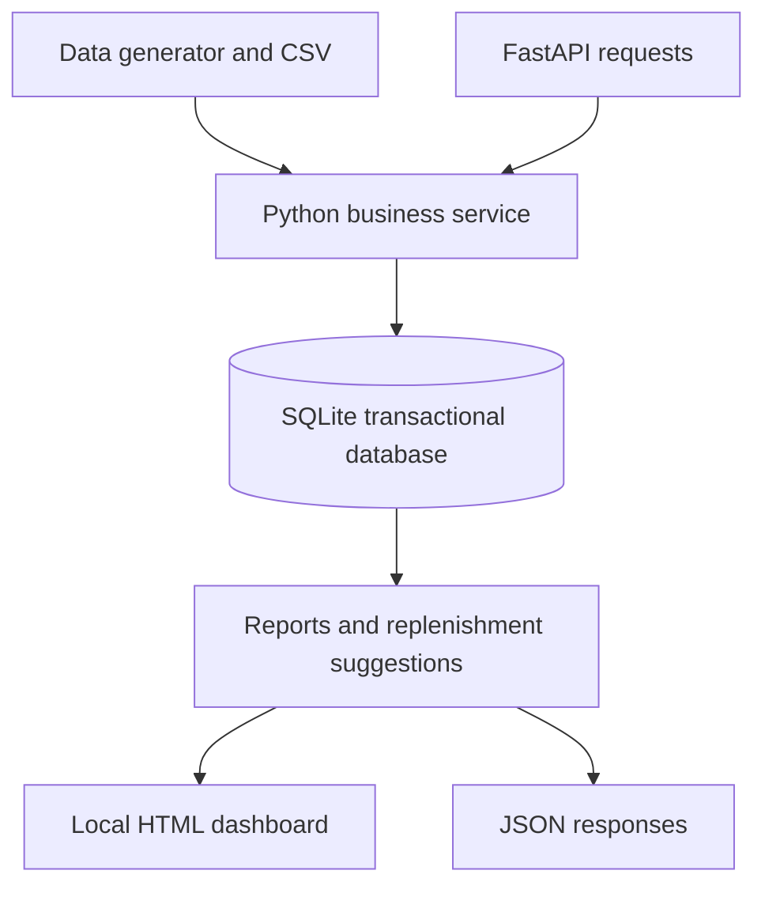
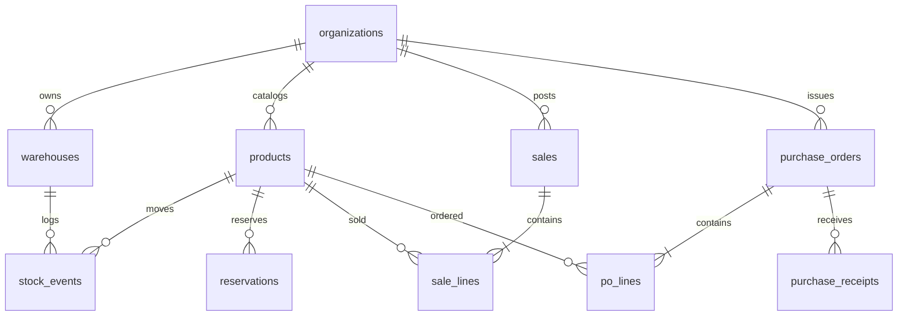

# StockFlow MVP — architecture and database design

## Goals and boundaries

The MVP models inventory as an auditable ledger, not as an editable `stock_qty` field. Organizations can have multiple warehouses, each with its own on-hand, reserved and inbound stock. All records use an `org_id` scope; no API authentication has been added yet, so local-only execution is mandatory.

## Relational schema

### Tables and keys

| Table | Primary key | Major fields / constraints |
|---|---|---|
| organizations | id (slug) | name, sector |
| warehouses | uuid | org_id, code; unique(org_id,code) |
| products | uuid | org_id, SKU unique per org, unit, precision, min stock, safety, lead/review days |
| stock_events | uuid | org_id/event_key unique, signed milli-unit delta, event type/date and SHA-256 fingerprint |
| reservations | uuid | org_id/ref unique, product and warehouse, qty, ACTIVE/RELEASED/CONSUMED |
| sales | uuid | org_id/sale_ref unique, warehouse, date, request fingerprint |
| sale_lines | uuid | sale_id, product, qty, unit-price cents |
| purchase_orders | uuid | org_id/po_ref unique, warehouse, supplier, expected date, status |
| po_lines | uuid | PO/product unique, ordered and received milli-unit quantities |
| purchase_receipts | uuid | org_id/delivery_ref unique, PO and request fingerprint |

All quantities are integer thousandths of the product's base unit. There is no floating-point stock quantity. For example, 2.375 kg becomes 2375 milli-units. Values use consistent input validation and fixed precision.

### Transaction invariants

- All writes use SQLite `BEGIN IMMEDIATE` and roll back on any exception.
- Outbound stock operations are rejected if they would reduce available stock below zero.
- A warehouse transfer inserts both outgoing and incoming ledger legs in a single transaction.
- Sales create explicit sales rows and matching outbound stock events atomically.
- Active reservations are excluded from availability, and a matched sale consumes its reservation.
- Duplicate request references with identical payloads are no-ops. Reused references with conflicting payloads fail.
- Purchase receipts cannot exceed ordered quantity, and pending purchase orders never increase physical inventory.
- CSV import is one transaction, not partial per-row persistence.
- Organization membership is checked for each product / warehouse access; SQL queries use placeholders (not string-built filters).

### Why not store current_stock as a mutable field?

A movement ledger supports traceability and reconstruction after errors. The trade-off is aggregation cost; a materialized snapshot per organization / warehouse / product is a future performance optimization. A snapshot should always be reconcilable to the underlying ledger.

### Limits of this MVP

- SQLite is single-writer and suited to local demonstration, not a distributed multi-tenant SaaS product.
- No API authentication, tenant authorizations, rate limiting or production access logging.
- Price input assumes unit prices are expressed as cents in one operating currency; no multi-currency accounting, discounts, tax or refunds.
- No returns linked to original sales, lot/serial tracking, expiry constraints, supplier selection or backorder management yet.
- No event reversal approvals or double-entry financial posting. Correction entries are possible but require governance for production.
- Reorder model is historical-average based; not machine learning or a production procurement decision engine.
- Inventory is computed for all product × warehouse combinations, including unused combinations; optimize sparse lookups for larger datasets.
- Input dates are ISO calendar dates; location-specific operational day cutoffs and time zones require configuration in later versions.

## PostgreSQL migration approach (planned, not yet implemented)

1. Use Alembic versioned migrations. Convert IDs to UUID, date strings to DATE, created_at to TIMESTAMPTZ, integer milli-unit values to BIGINT.
2. Implement organization-aware compound foreign keys or row-level security; application checks alone are insufficient for production tenant isolation.
3. Add row-level locks (`SELECT ... FOR UPDATE`) on stock-balance aggregates or dedicated stock snapshot rows to safely enforce availability under concurrent writers.
4. Define explicit decimal currency with currency code, standardized UoM conversion rules, indexes on org/date/warehouse/product and auditing/tracing.
5. Add idempotency token expiry policies and defensive replay handling for distributed n8n integrations.

## API surface (MVP)

GET /health, /dashboard, /organizations  
GET /organizations/{org}/inventory, /daily-report, /reorder-suggestions, /purchase-orders, /sales-trend  
POST /movements, /sales, /reservations, /transfers, /purchase-orders, /purchase-receipts

Browsable Swagger interface available at `/docs`. Requests are validated by Pydantic at the HTTP boundary and again by the service's business rules. Do not expose the server beyond localhost.
